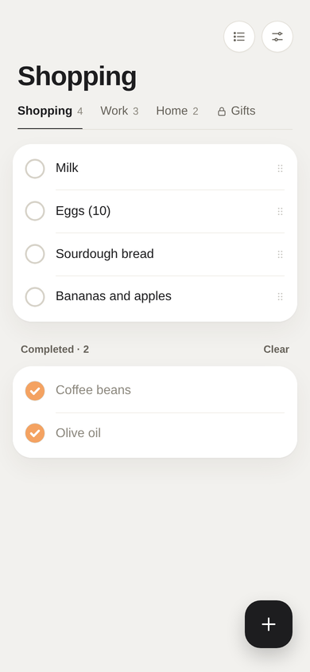
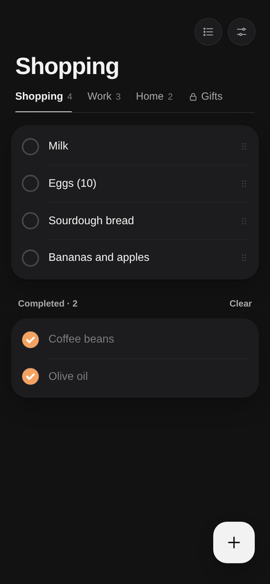

# To-Do Lists (web)

Your to-do lists from the [To-Do Lists](https://github.com/MaNi4/omarchy-todo-lists) Omarchy plugin, on your phone.
A small web app you add to the home screen, on iPhone or Android: the same lists in tabs, the same locked lists,
end-to-end encrypted, synced through the same private GitHub repository. It works offline and syncs when the phone
is online.

**https://todo.dobrovodsky.dev**

<p>
  
  
</p>

## Where your data lives

Only on your devices and in your own private GitHub repository: on the phone (inside this app, encrypted), on
your computer (the Omarchy plugin, encrypted), and in the repository as one encrypted file that carries changes
between them. There is no server, cloud service or account of this project, and no analytics or tracking.

This site is the app's code only (static files on GitHub Pages). Your lists never pass through it: the phone
reads and writes the encrypted file in your private repository directly, and opens it with your master password.

## On the phone

1. Open **https://todo.dobrovodsky.dev**: on iPhone in **Safari**, on Android in **Chrome**.
2. iPhone: Share › **Add to Home Screen**. Android: ⋮ › **Install app** (or Add to Home screen). Then open it from
   there (as a home-screen app its data is kept for good; in a browser tab, iOS may clear it after a while).
3. Connect: the private repository your plugin syncs to (`owner/repository`), a GitHub token for it, and
   your master password.

The token: github.com › Settings › Developer settings › Fine-grained tokens › Generate new token.
Repository access: only that repository. Permissions: Contents, read and write. Use a token of its own for
the phone, so it can be revoked alone.

## What it does

- Tabs of lists; tap a to-do to tick it, swipe it left to move it to another list, edit or delete it (swipe all
  the way to delete), drag its handle to reorder it, and **+** to add one. A deleted, cleared or moved to-do comes back
  with **Undo**.
- **Export as Markdown** (Settings): your lists as a plain text file, to save in Files or send.
- **Lists**: add, rename, reorder (drag), lock with a list password, change or remove a lock, delete.
- Locked lists lock again when you leave the app. A forgotten list password or master password opens
  with the recovery key.
- **Settings**: sync now, a new master password, a new recovery key, forget the master password on this
  phone, disconnect the phone.

## Security

- The file is the plugin's: AES-256-GCM with a random data key; the key is wrapped with the master password
  (Argon2id, 64 MiB) and for the recovery key (P-256 ECDH). Locked lists have a key of their own, wrapped with
  their list password. The format is described in `src/lib/crypto.js` and `src/lib/model.js`.
- On the phone: the data key is kept in IndexedDB as a WebCrypto key that cannot be read back out; the token
  is sealed with it; the lists are kept as the same encrypted file. Nothing else is stored.
- The file's header is signed with a key derived from the data key: a header changed on GitHub by anyone without
  the key is refused.
- The page may only talk to `api.github.com` (Content Security Policy), and does not run inside another page's frame.
  No analytics, no other servers. It is served from a domain of its own, so no other site shares its storage.
- Argon2id runs in WebAssembly ([hash-wasm](https://github.com/Daninet/hash-wasm)); everything else is the
  browser's WebCrypto.

## Development

```bash
npm install
npm run dev          # http://localhost:5173; /?en#demo opens the demo lists, no network
npm test             # compatibility with the plugin, the model, syncing
npm run build        # dist/, published by .github/workflows/pages.yml
```

`tests/fixtures/plugin-v3.json` is a file the plugin wrote (`scripts/make-fixture.py`); the tests open it, and
write `tests/fixtures/web-v3.json` for the plugin's own tests to open. Both apps must read each other's files.

## License

MIT
